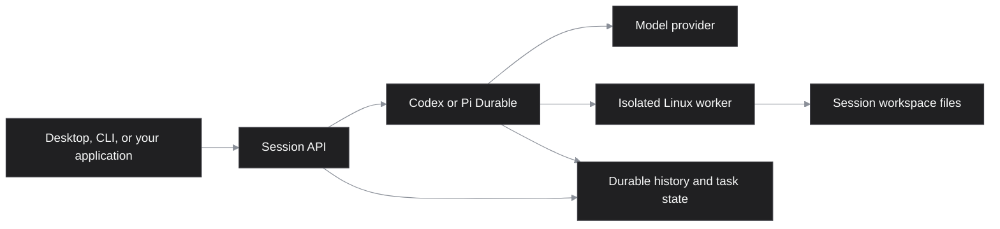

<h1>
  <picture>
    <source media="(prefers-color-scheme: dark)" srcset="assets/brand/rat-things-lockup-dark.svg">
    
  </picture>
</h1>

Rat Things runs AI agents on your computer or in your AWS account. It saves their
conversations and work so you can return later, continue after a worker stops, or
run tasks on a schedule. Use the Rust desktop app, CLI, or OpenAI-compatible Agents API.
It is for developers building coding agents and services that need saved work,
isolated execution, and control over their infrastructure.

Start locally with Codex or Pi Durable and your ChatGPT subscription. AWS runs either runtime
in isolated Linux workers, with encrypted storage and explicitly configured tools.
On AWS, Pi uses Amazon Bedrock. AWS compute and model usage are billed separately from your
subscription.

This is an engineering preview. See [capabilities and boundaries](docs/status-and-roadmap.md)
for implemented features and current limits, and [security](docs/security.md) before
connecting sensitive accounts.



Local execution uses private storage on your computer. AWS execution uses workers
and encrypted storage in your account. The model provider is a separate service.

## Start at home

```bash
npm ci
npm run rat-things -- login
npm run console:build
npm run console:serve
```

The desktop opens **This computer** when no cloud endpoint is configured. Pick a
small task, choose a model, and start a Session. Your conversation is there when
you return. Building the desktop requires Rust 1.95 or newer.

Prefer a terminal? Run `npm run rat-things -- serve`, then use the same
`sessions create`, `sessions send` and `sessions items` commands. Local Sessions
support conversations and function tools; Codex also supports web search. Codex and
Pi Durable can use isolated Linux workspaces with a supported local VM and `runtime setup`.
Apple silicon Macs use a VM-backed container engine. An explicit
[Linux x86-64 KVM development setup](testing/local-runtime/linux-kvm/README.md) is
available from source. Vaults and provider integrations remain cloud capabilities.
Local Codex and Pi Durable use your ChatGPT subscription.

Follow the [local workspace guide](docs/local-workspace.md) for setup, persistence,
capacity and the path into AWS. The desktop's workspace menu connects to an existing
AWS deployment without changing the Session interface. **Review Session copy**
prepares a separate, resumable transfer of history, settings and workspace files.


## Install in AWS

From a clone, with Node.js 22.20+, Terraform 1.16+, AWS CLI credentials, and Docker
able to build Linux ARM64 images:

```bash
npm run quickstart:aws
```

The command installs dependencies, validates or builds the pinned worker runtime,
checks your AWS identity and model access, and asks before deploying. It uses
Bedrock, private AWS endpoints, and no public runtime egress by default. It then
verifies two Turns and removes the test Session. The deployment remains available.
Private endpoints and other AWS resources incur charges while the deployment exists.

Optionally add a monthly AWS account spending alert before deploying:

```bash
npm run quickstart:aws -- --budget-usd 50 --budget-alert-emails you@example.com
```

Replace the example amount and address. The alert covers the selected AWS account,
including its other workloads. It emails when reported monthly costs exceed the
amount; it does not stop spending. Omit both options to skip it.

Use `npm run quickstart:aws -- --dry-run` to inspect the configuration and
`npm run quickstart:aws -- destroy` to remove it. See the
[AWS quickstart](docs/quickstart.md) for profiles, models, and public HTTPS exceptions.

## Choose Codex or Pi Durable

Codex is the default. Select Pi Durable with `--runtime pi` in the CLI or
`metadata: { rat_things_runtime: 'pi' }` in an Agent or Session request.
The runtime stays fixed for that Session. Model changes use its approved catalog.

From a source checkout, run `npm ci` and [configure your deployment endpoint and AWS
identity](docs/quickstart.md#connect-an-installed-deployment), then use:

```bash
npm run rat-things -- agents models --runtime pi
npm run rat-things -- sessions create --runtime pi --model YOUR_ADMITTED_BEDROCK_MODEL \
  --input "Explain the task you can help with." --stream
```

Pi Durable saves conversations, pending tasks, and tool results. Rat Things adds
isolated workers, encrypted storage, worker ownership checks, and durable subagent
coordination. A replacement worker can recover committed work without depending
on the original machine. Workspace recovery has separate checkpoint requirements.

Read [Codex and Pi Durable](docs/agent-runtimes.md) for shared features and runtime
limits, or [run Pi Durable on Bedrock](guides/run-pi-durable-on-bedrock.md) to get started.
The [recorded recovery demo](testing/pi-durable-demo/README.md)
shows a killed worker and a helper that finishes on its replacement, using scripted
model replies and simulated host storage.

## Use the cloud API

After `npm ci && npm run build`, use the Terraform `agents_api_base_url` output
and an AWS principal authorized to invoke the deployment's token issuer. The included transport obtains and refreshes
a scoped bearer credential for the official OpenAI SDK:

```ts
import { createAgentsClient } from './dist/agents-client.mjs';

const client = createAgentsClient({
  baseURL: process.env.RAT_THINGS_AGENTS_API_URL,
  region: process.env.AWS_REGION,
});
const agent = await client.beta.agents.create({
  model: process.env.AGENT_MODEL,
  instructions: 'Answer clearly and concisely.',
  metadata: { rat_things_runtime: 'pi' },
});
const session = await client.beta.agents.sessions.create({
  agent_id: agent.id,
  environment: { type: 'none' },
  input: 'Explain the task you can help with.',
});
```

This example selects Pi Durable. Omit its runtime metadata to use Codex, and choose
a model allowed by that runtime's deployment catalog. Environment templates define
managed workspace setup, network access, files, and runtime-supported capabilities.
The upstream `openai_hosted`
discriminator selects a managed environment running in **your AWS account**.
Codex also supports self-hosted executors through the private authenticated relay.

The [Agents API guide](docs/agents-api.md) covers authentication, resources,
continuation, streaming, tools, files, environment connections and current limits.
The [agent operating guide](docs/agents.md) provides a concise entry point.

## Explore design directions with Session forks

Fork a prepared managed Session into independent conversations and workspaces.
Keep its context and files, try different approaches, and discard the branch you
no longer need. Forking uses the latest terminal root Turn and is opt-in through
`session_checkpoints_enabled` with S3 Files configured.

[Watch the 42-second demo video](https://gpazo.github.io/Rat-Things/assets/session-fork-demo.mp4?v=five-forks-42s):
one UI, five independent design directions, and an evaluation before choosing one.
The captioned replay reviews the real fork outputs on desktop and mobile, explains
their tradeoffs, and discards the four unchosen Sessions. Five is an example; repeat
the fork endpoint for the alternatives your deployment can support.
The [Fork studio guide](docs/session-fork-demo.md) also includes a two-direction hands-on walkthrough.
Run `npm run demo:fork` for the no-cloud version, or follow the guide to connect
the UI to real Sessions in your deployment.

## Provider events and schedules

Authenticated GitHub, GitLab, Slack and Teams events resolve an operator-owned Agent
binding. Each event has a durable input receipt; Slack and Teams retain Session
continuity within a sender's thread. Delivery follows root Turn completion and
runs independently of Session execution.

Schedules reference an Agent and environment. They retain occurrence identity,
input templates, time zones and overlap policy without defining another kind of
agent. See [schedules and provider bindings](docs/schedules.md).

Connections retain provider installation, OAuth refresh, grant narrowing and
notification access. Agent-facing tools are explicitly declared on Agents;
notification credentials do not silently add tools.

## Develop Rat Things

```bash
npm ci
npm run smoke:local
npm run console:build
npm run console:serve
```

For the full repository checks, run `npm run check`. It includes Lambda packaging
and requires an official Linux ARM64 Codex artifact, Docker and Terraform; see
[development prerequisites](testing/README.md). To deploy a backend, start with
the [AWS quickstart](docs/quickstart.md).

The console is a native Rust desktop app built with egui. It requires Rust 1.95 or newer to build.
Its private Node helper reuses the CLI authentication code. See [the desktop guide](desktop/README.md).

The CLI supports `agents`, `sessions`, `environments`, `files`, `vaults` and `schedules`.
Use `npm run rat-things -- agents --help` for resource commands. Local execution,
connection installation, diagnostics and deployment tooling remain available.
Codex and Pi Durable versions are pinned in the runtime build. Standalone local
execution uses Codex or the mock driver; Pi Durable runs through durable Sessions.

The reusable Terraform module is `infra/modules/agent-runner`; `infra/` is its
root example. Build Lambda artifacts before validation. Lambda and MicroVM builds
use ARM64 (`linux/arm64`). Ordinary tests never provision a MicroVM.

## Boundaries

The harness drops the agent process to a separate non-root UID inside a Lambda
MicroVM or dedicated EC2 worker. Worker ingress is private. Provider requests are
authenticated before parsing, owners come from trusted identity, clone URLs are
HTTPS and host-allowlisted, and state changes use conditional writes. Prompts and results live in encrypted S3; DynamoDB
holds indexes and references. Integration credentials remain behind host-side brokers.
The optional [ChatGPT login bridge](docs/codex-subscription.md) exposes its runtime
authentication file to the agent UID and requires trusted workloads.

Capabilities are fixed before launch. Rat Things has no mid-Turn approval layer;
an operation outside the allowed capabilities remains unavailable.

See [AGENTS.md](AGENTS.md) for contributor boundaries and commands, and the
[documentation](https://gpazo.github.io/Rat-Things/docs/agents-api/) for operation.
