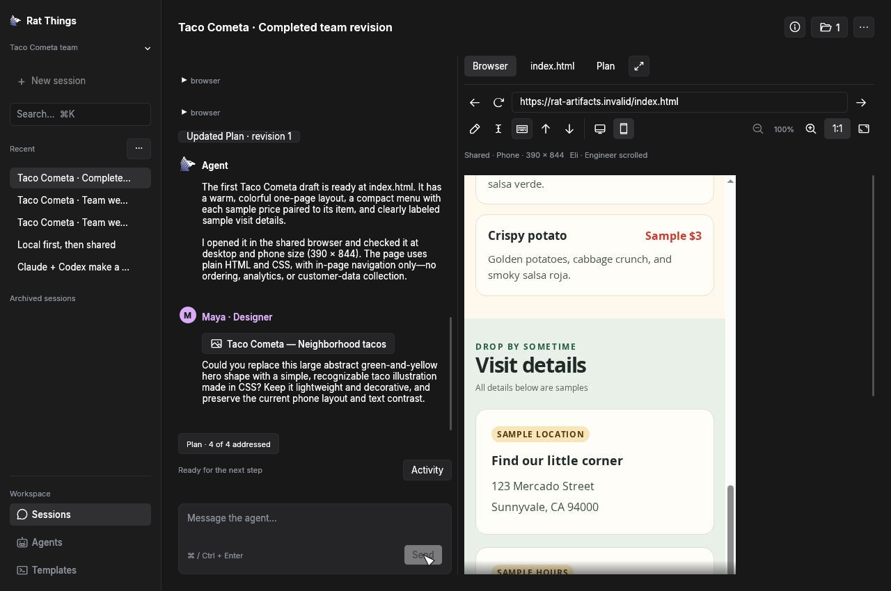
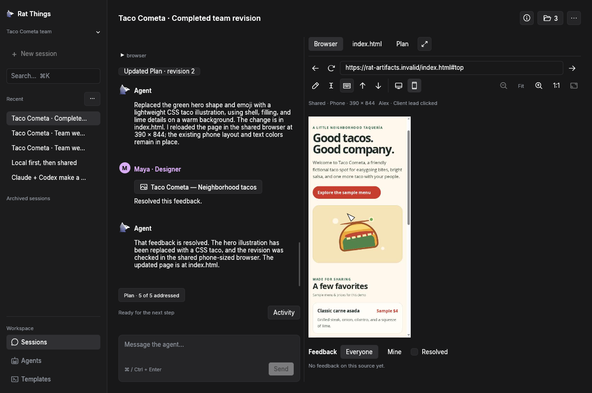
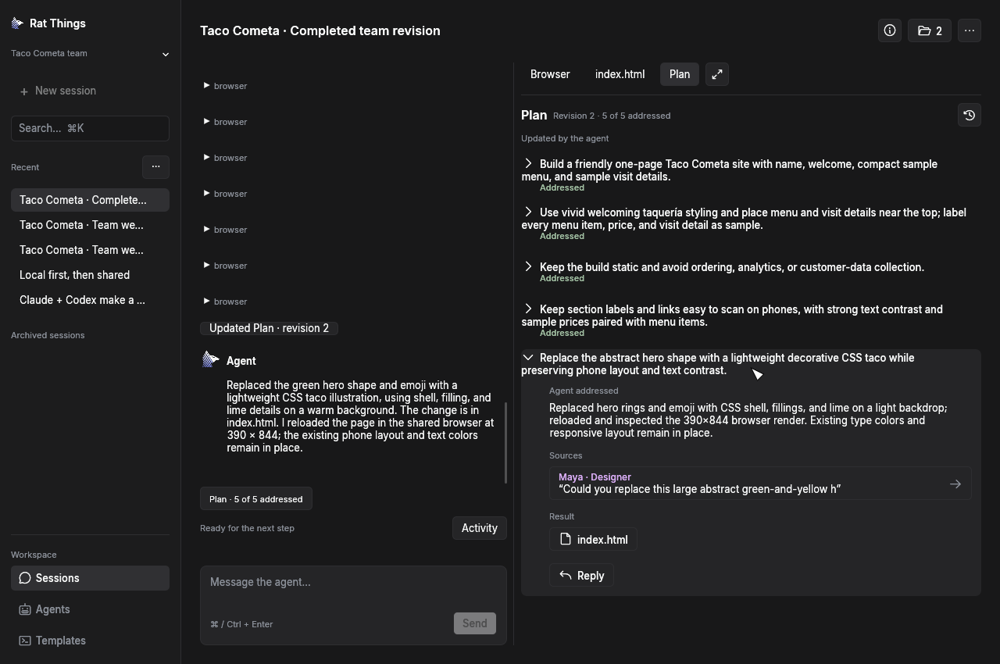
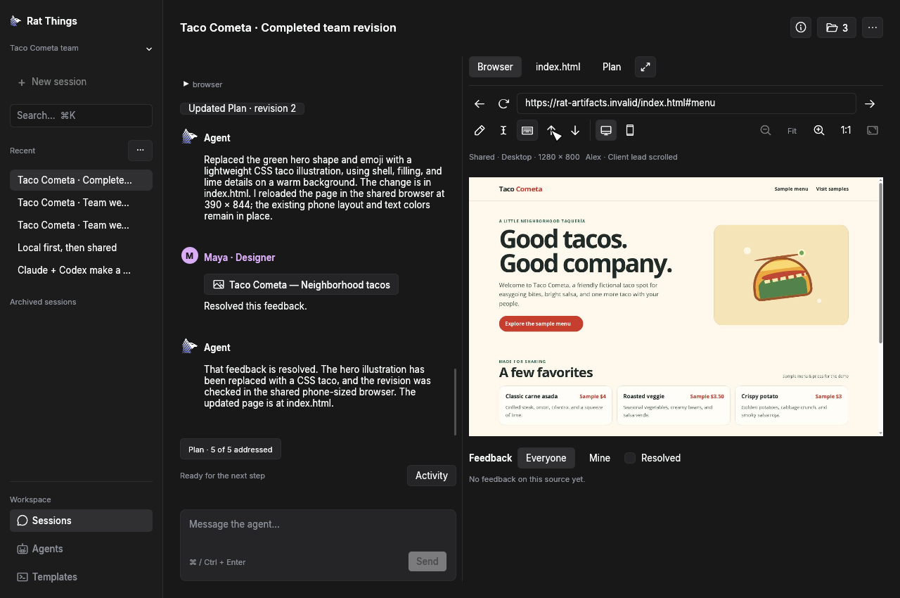

# Taco Cometa: completed four-teammate revision

The rerun completed the full loop: four teammates contributed to one coding
Session, reviewed its first website, published a captured design annotation,
received a completed revision, and independently reviewed it. The designer then
confirmed the annotation as resolved. This is local evidence, not an AWS or load
test.

## What changed before this run

- The shared browser identifies its viewport and most recent **confirmed**
  collaborator action. Attribution is host-written and bound to the exact worker
  epoch and frame revision; failed intentions and older actions cannot claim the
  current frame. Captured pages display their own stored dimensions.
- **1:1** makes phone text readable without changing anyone else's browser size.
  Fit remains available. Slow explicit actions show an updating state; the native
  test bridge waits for the action's own outcome and reports errors or pending
  work instead of assuming a dispatched click succeeded.
- Plan guidance asks the agent to preserve separate actionable requests and
  checks, keep stable item identities, and explain addressed/deferred states.
  This is agent guidance, not a semantic guarantee that “addressed” is correct.
- Browser schemas and validation explain normalized coordinates, required frame
  context, scroll units and viewport limits. Invalid actions still fail closed.
- The simulation has a pure budget planner and a bounded review phase instead
  of immediately destroying the browser at a coding limit. Cleanup exports the
  latest HTML first. Missing usage is recorded as unknown, not zero.

These changes retain the fixed Session capability envelope and existing roles.
There is no browser ownership lock or authority escalation. Four collaborators
still share one page; local zoom and captured review are personal views.

## Method and outcome

Four independent GPT-6 Luna teammate contexts used four simultaneously connected
production Rust ConsoleApps through native controls: Alex (client lead), Maya
(designer), Eli (engineer) and Sam (QA). The reasoning workers were scheduled
within the available three subagent slots; this was not four simultaneous model
requests. One subscription-backed Luna coding agent worked in the real isolated
local Linux worker with SQLite and Chromium. Authentication was demo-only
loopback collaborator tokens, not OIDC. The consoles were headless egui instances,
not OS-window automation. Teammates did not edit the website or use API shortcuts.
The parent read durable activity and exported files to verify their observations.

All four identities contributed during the first Turn and had distinct colors.
Five initial chat contributions were saved: the engineer sent two versions after
misreading successful delivery. Plan revision 1 retained four separate items with
source receipts and artifact links.

Maya's captured region requested a recognizable CSS taco instead of the abstract
hero decoration. That one annotation reached the second Turn. The finished file
replaces the emoji and rings with CSS shell, fillings and lime; surrounding page
content and its sample labels remain. Plan revision 2 adds a separate addressed
item linking the annotation's message to the revised artifact.

All four teammates completed their final reviews. QA exercised the sample-menu
link on the revised phone page. Maya inspected the Plan’s source/result linkage and
resolved the feedback. An assisted recheck using the Resolved filter confirmed
its state in her own client. Original observations and assisted corrections are
preserved separately in the [review reports](reviews/).

The parent additionally inspected the final desktop hero, menu and visit sections
through the native client. The first and final HTML hashes differ; the final
export matches the cleanup export. See [revision.diff](revision.diff),
[metrics.json](metrics.json), [activity.json](activity.json) and
[native-actions.json](native-actions.json).

| Run stage | Turn duration | Reported tokens, including cache |
| --- | ---: | ---: |
| First draft | 104 seconds | 294,119 |
| Requested revision | 126 seconds | 554,736 |
| Resolution acknowledgment | 2 seconds | 43,819 |

These are observed Turn durations from one run, not submission latency, time to
first visible progress, or a controlled performance comparison. Total reported
usage was 892,674 tokens: 833,280 cached input, 48,806 uncached input and 10,588
output. The run stayed under its declared limits of four Turns, 1.2M observed
tokens, 120 tool items and 35 active minutes plus 10 review minutes. It finished
and was cleaned up after roughly 9 minutes 47 seconds of server lifetime. No
budget cutoff or cancellation was needed; that branch is covered by deterministic
planning tests, not by this live run.

## Final teammate feedback

Ratings are subjective reports from simulated teammates, not measured usability
scores. Each reviewer distinguishes observed behavior from untested claims.

| Reviewer | Clarity | Collaboration | Artifact review | Verdict |
| --- | ---: | ---: | ---: | --- |
| [Client](reviews/client-final.md) | 4/5 | 5/5 | 4/5 | Fits the fictional-site brief; review the full responsive page before handoff. |
| [Designer](reviews/designer-final.md) | 5/5 | 5/5 | 4/5 | Captured design request satisfied; source/result linkage verified. |
| [Engineer](reviews/engineer-final.md) | 5/5 | 4/5 | 4/5 | Revised phone page and five Plan items visible; source correctness not independently checked. |
| [QA](reviews/qa-final.md) | 5/5 | 5/5 | 4/5 | Revised phone page and menu navigation accepted for the demo. |

## Remaining findings

1. **Make successful actions unmistakable.** Eli retried a message that had
   already arrived. Maya retried Resolve after it had succeeded and disappeared
   under the default filter. Durable history and later native inspection
   confirmed both operations. A brief saved/resolved confirmation would reduce
   this uncertainty without changing permissions or agent-owned Plan status.
2. **Reduce unnecessary inference.** Resolving feedback generated a third Turn
   solely to acknowledge it: 43,819 reported tokens, mostly cached. The worker
   also lacked `rg`, requiring a fallback. The browser rejected one missing frame
   context, one stale revision during concurrent review, and one scroll missing
   coordinates; the agent recovered. Clearer action-specific required fields and
   readiness reporting could avoid some extra round trips. None were silently
   accepted or treated as permission to widen access.
3. **Improve review ergonomics and completion evidence.** 1:1 is more readable,
   but the phone page exceeds the panel height. The designer's first scripted
   region crossed the visible clipped area and needed another attempt. The
   shared page moved during review; the new actor/viewport cue helped explain it.
   Keep Fit and 1:1 explicit, improve capture/selection guidance, and show pending
   feedback as working in the Plan before the final addressed update. This run
   demonstrates granularity, not continuous intermediate Plan updates.

The demo sidebar also lists older Sessions whose routes are intentionally blocked
by its single-Session proxy; Alex briefly opened one. This is harness scope
confusion, not evidence that normal Session routing is broken. The final reports
also request broader desktop, keyboard and accessibility checks. The parent's
additional desktop inspection covers visible layout only.

## Validation and limits

Repository tests: **3,137 passed, 86 skipped** (347 test files passed). Architecture,
schema/route/worker generation checks, typecheck and MicroVM syntax checks passed.
Rust validation passed with **82 unit and 29 native interaction tests**, all-target
clippy and formatting; the final saved-capture and rejected-action cases also
passed after their last edits. Packaging smoke-tested 15 Lambda bundles; site
build and all three Terraform format/validation targets passed. `git diff --check`
passed.

The full check did not finish green in one invocation: the first run hit a
20-second packaging-fixture test timeout under competing builds. That suite
passed alone and in the final full test run. The latter passed all 3,137 tests,
then esbuild ran out of disk space. After removing regenerable Rust incremental
compiler cache, packaging and every remaining check stage passed. No source or
simulation evidence was removed. See [validation.json](validation.json).

A two-native-client deterministic integration exercised the real Linux browser,
shared resize attribution, 1:1, annotation persistence and reopening a saved phone
capture after another collaborator changed Desktop. Ten browser tests passed
with real Chromium enabled. The fresh live four-client run completed all driver
processes successfully. Independent Luna code and stageshow visual reviews covered
the changed contracts, completed-action attribution, saved-size display and pending
state. The review found the async error-reporting flaw, which was fixed and retested.

Not revalidated: AWS, OIDC, broad RBAC/revocation integration, high-concurrency load,
latency/cost scaling, OS accessibility or screen readers, full responsive/a11y
coverage, image-only feedback comprehension by the model, and hard-budget
cancellation/review expiry against a live provider. The annotation text was
sufficient to identify the requested change, so this does not isolate whether the
model understood the captured pixels. Prompt guidance improved this run's Plan,
but does not guarantee semantic completeness in other tasks.

No paid model API calls or AWS resources were used. Coding inference used the
existing ChatGPT subscription and gpt-6-luna, with no fallback. Delegated analysis
used Luna; its token/billing totals and local energy costs are unavailable. The
subscription's per-run monetary allocation is also unavailable; $0 paid API spend
is not a claim that all compute was free.

[Cleanup evidence](cleanup.json) records removal of the server, local services,
private connection file and both worker volumes. An exact-name Docker check found
no remaining run container or volumes. The sign-in profile remains for reuse.

## Evidence images

