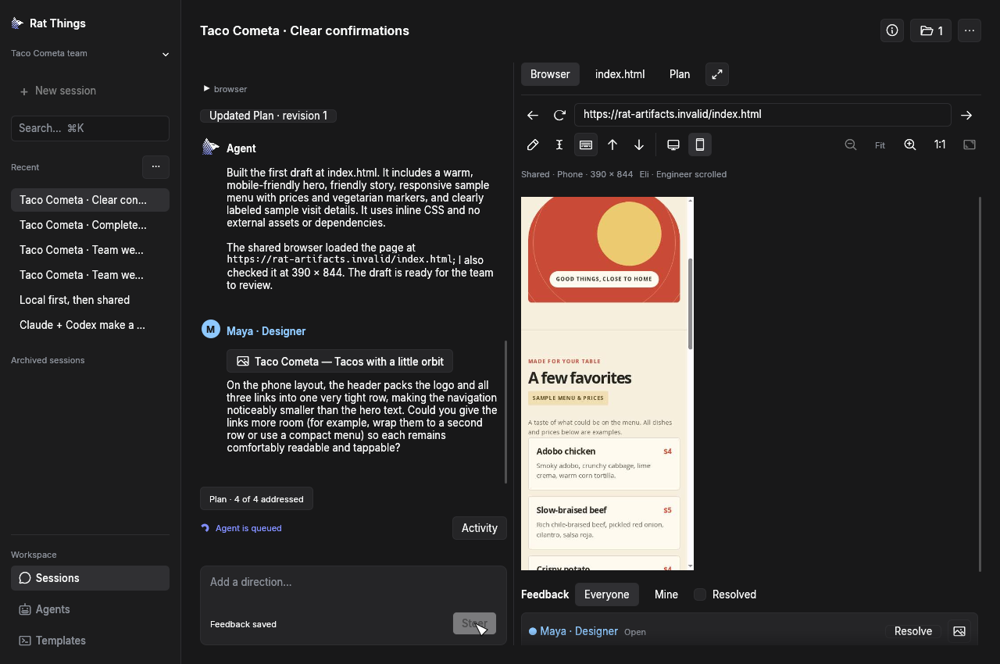
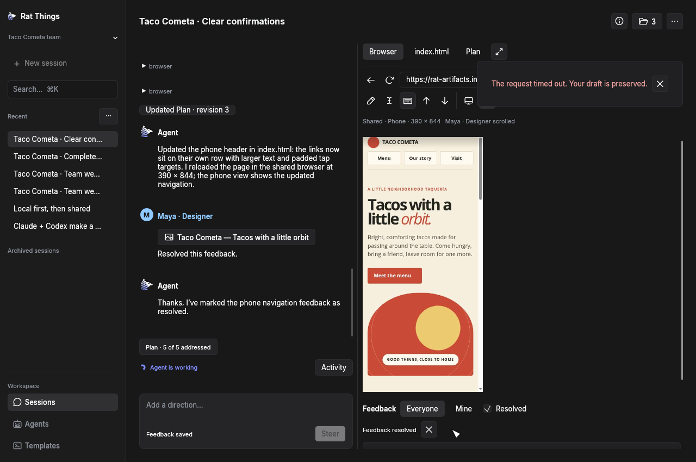
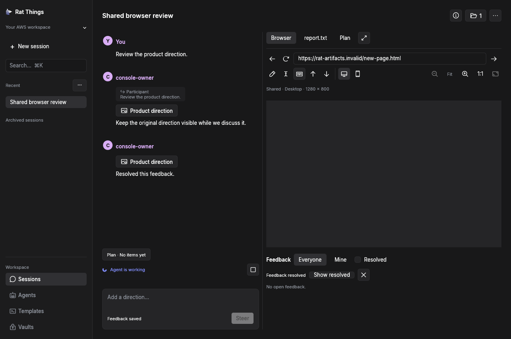

# Clear confirmations: completed four-teammate simulation

The selected Saved/Resolved finding is implemented and the fresh simulation
completed a website draft, a captured revision request, the actual revision,
resolution, and all four independent final reviews. The designer used Resolve
once, saw **Feedback resolved**, and found **Show resolved** without assistance.
The four initial messages, one annotation and one resolution produced exactly six
durable input receipts. No duplicate submission occurred in this run.

## Changes

- The composer shows **Saving…**, then **Message saved** or **Feedback saved**
  only after the matching mutation acknowledgment. A failed request keeps the
  draft and shows a failure state. A new draft or Session navigation removes the
  old success confirmation. Saved means accepted into the Session; it does not
  claim that the agent has addressed the contribution.
- Resolve and Reopen show a pending state and a persistent confirmation after
  acknowledgment. **Show resolved** reveals a discussion hidden by the existing
  filter. Dismissal is a small icon action. The agent-owned Plan remains separate.
- Routine browser-frame reads no longer briefly disable attached Send or
  Resolve. These actions fence the background read using the existing generation
  mechanism; explicit browser actions and capture work still retain their gate.
- The native simulation bridge waits for the contribution's actual save result,
  as well as browser actions, and reports failure instead of assuming that a
  dispatched click succeeded.

Pstack's root-cause and prove-it-works workflow guided the async-state review.
Functional-programming guidance kept request settlement in a small typed
transition, separate from effects and rendering. Stageshow was applied to the
actual Rust console. Independent Luna code and visual reviews checked request
fencing, source scope, narrow/wide layouts and the recovery action. The visual
review prompted changing “Show” to **Show resolved**.

Confirmations are local UI receipts, not new durable records or permissions.
They persist until a relevant new action, dismissal or navigation so they cannot
expire before being noticed. Artifact resolution notices match the selected
artifact; browser notices follow the existing one-browser, Session-wide feedback
list. The capability envelope, role checks and Plan ownership are unchanged.

## Live exercise

Four fresh Luna teammate contexts used four concurrently connected production
Rust ConsoleApps: Alex (client lead), Maya (designer), Eli (engineer) and Sam (QA).
The reasoning contexts ran in waves within three available delegation slots;
the native clients remained connected together. One real Luna coding agent used
the local isolated Linux worker, SQLite and Chromium through the existing
ChatGPT subscription. The participants used native controls only; the parent
read activity and exported artifacts for verification.

This was headless egui interaction, not OS-window automation. Authentication used
demo loopback collaborator tokens, not OIDC. The website was fictional Taco
Cometa, with sample operational details and no deployment or real transactions.

The first Turn incorporated all four participants' attributed messages and
created a page. Maya selected the phone header's **Visit** link in a captured
browser view and asked for less cramped navigation. She independently identified
the **Feedback saved** status and Open discussion. The agent added a separate
Working Plan item, then changed the phone CSS so navigation occupies its own row
with larger text and padded links. Plan revision 3 marks that item addressed,
linking the original receipt/message and revised artifact hash.

All four teammates inspected the completed revision. Maya resolved the feedback
once and used **Show resolved**. Other clients saw the resolution in the shared
conversation and the updated feedback list. QA also inspected the sample menu,
vegetarian labels, story and sample visit details. No teammate exercised the
page links or keyboard navigation; this establishes the visible revision and
collaboration loop, not comprehensive website acceptance.

The first/final HTML hashes differ; the final export matches the cleanup export.
See [revision.diff](revision.diff), [activity.json](activity.json),
[native-actions.json](native-actions.json) and [metrics.json](metrics.json).
All 47 recorded UI actions returned successful outcomes. A QA bridge invocation
with an uppercase role name failed before reaching the client and was corrected;
that harness mistake remains in the round-one report.

| Stage | Turn duration | Reported tokens, including cache |
| --- | ---: | ---: |
| First draft | 150 seconds | 187,475 |
| Requested revision | 50 seconds | 218,158 |
| Resolution acknowledgment | 2 seconds | 37,485 |

These are one run's Turn durations, not submission latency or a controlled
performance comparison. Total reported usage was **443,118 tokens**: 384,000
cached input, 50,237 uncached input and 8,881 output, across 11 tool items. The
run stayed within four Turns, 1.2M observed tokens, 120 tool items and 35 active
minutes plus a bounded review period. It was cleaned up after about 12m19s of
server lifetime; no budget cutoff was needed.

## Final team review

Scores are subjective simulated-teammate feedback, not measured usability scores.
Reports preserve initial uncertainty and recovery; copied reports only normalize
screenshot paths to the evidence directory.

| Reviewer | Clarity | Collaboration | Artifact review | Outcome |
| --- | ---: | ---: | ---: | --- |
| [Client](reviews/client-final.md) | 4/5 | 5/5 | 4/5 | Revised navigation, Plan and team resolution visible. |
| [Designer](reviews/designer-final.md) | 5/5 | 5/5 | 4/5 | Request satisfied; Saved and Resolved understood without assisted recovery. |
| [Engineer](reviews/engineer-final.md) | 4/5 | 4/5 | 4/5 | Revision traceable through chat, Plan and preview. |
| [QA](reviews/qa-final.md) | 4/5 | 5/5 | 4/5 | Header and lower page content reviewed visually. |

### Remaining findings

1. **Unscoped timeout notices undermine status clarity.** All four reviewers saw
   “The request timed out. Your draft is preserved.” after fresh page, chat and
   Plan data were visible. QA dismissed it successfully. The generic API error
   formatter supplies that draft wording for any request timeout, and the general
   error banner persists independently of subsequent successful reads. This run
   did not instrument which request timed out, so its exact network cause is
   unknown. Scope errors to the operation and retire recovered read errors in a
   follow-up. The new save receipt remained successful; no lost message was found.
2. **Persistent Saved wording can still be ambiguous.** Client and engineer
   understood the initial acknowledgment but later questioned “Message saved”
   beside an empty composer. It intentionally refers to the last submission,
   not draft autosave. A closer association with that message may be clearer;
   the current tooltip and user guide explain the distinction. This run supports
   better immediate feedback, not perfect long-lived status clarity.
3. **Resolution still starts an acknowledgment Turn.** Existing behavior consumed
   37,485 mostly cached tokens solely to acknowledge resolution. This pass did not
   change routing or suppress that Turn. Review coverage also remains phone-only
   and visual; keyboard, links, broader responsive and accessibility checks remain.

## Validation and cleanup

`npm run check` passed in one invocation: architecture and generated contracts,
typecheck, MicroVM syntax, **3,137 tests passed / 86 skipped**, packaging and Lambda
bundle smoke checks, site build, and all three Terraform formatting/validation
targets. No AWS resources were provisioned.

`npm run console:check` passed with **84 unit and 30 native tests**, all-target
clippy and formatting; eight opt-in harnesses were skipped. After the final
recovery-button copy and background-read priority adjustment, formatting,
all-target clippy and the held captured-feedback/resolution test passed again.
All four live native drivers used the final build and exited successfully.
`git diff --check` passed. [Validation details](validation.json) and
[check logs](checks/logs/) retain the exact scope.

Held-response tests cover pending/success/failure, retry, new drafts, source and
Session navigation, reply retargeting, resolving/reopening and filter recovery.
Native frames cover 1280×850 and 900×650. Status labels expose explicit AccessKit
labels and polite status semantics; actual OS screen-reader announcements were
not tested.

Not revalidated: AWS, OIDC, broad RBAC/revocation integration, high-concurrency
load/latency scaling, OS accessibility, complete website behavior, image-only
annotation comprehension, and hard-budget cancellation with a live provider.
The annotation text was sufficient to describe the revision, so this run does
not isolate comprehension of captured pixels.

No paid model APIs or AWS resources were used. Coding inference used the existing
ChatGPT subscription and **gpt-6-luna**, without fallback. Delegated analysis used
Luna; its token/billing totals, subscription cost allocation and local energy
costs are unavailable. Zero direct paid API spend is not a total compute-cost
estimate.

[Cleanup evidence](cleanup.json) records removal of the loopback server, local
services, private connection file and both worker volumes. Exact Session-name
checks found no remaining container or volume. The reusable sign-in profile and
existing runtime image were retained.

## Evidence

The first two images are actual live collaboration frames, including the
unresolved timeout-banner finding. The last image is the deterministic native
fixture used to verify confirmation placement and recovery.

