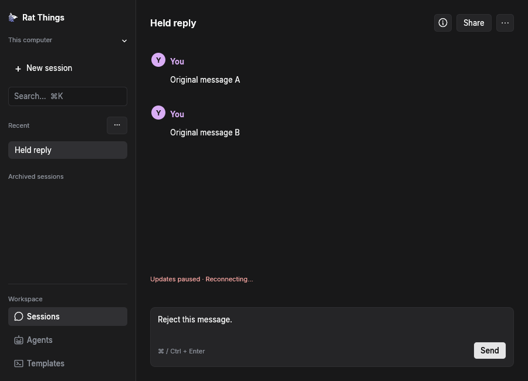
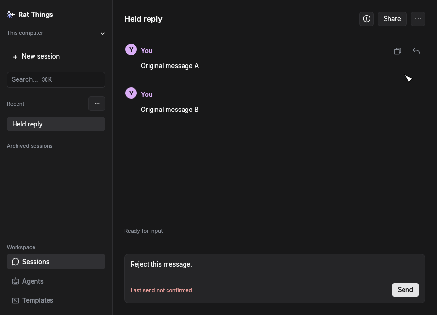
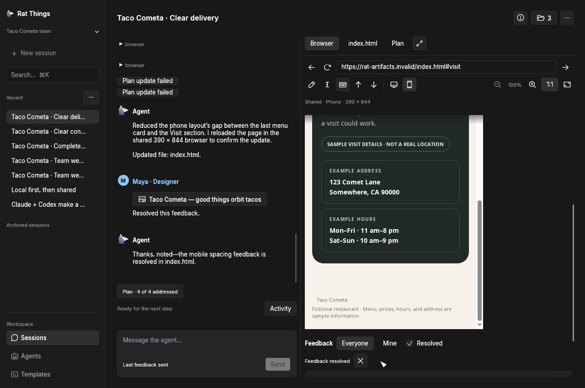

# Read recovery and clear submission receipts

Both requested UI fixes are implemented. The fresh four-teammate simulation
completed a website draft, captured feedback, a real revision, resolution and
four final reviews. All reviewers understood the sent receipt as their earlier
contribution, separate from agent progress. No stale timeout banner appeared in
the 55 recorded UI actions; no contribution or resolution was duplicated.

The rerun also exposed a separate **Plan update recovery gap**: the agent supplied
a mistyped source-message ID twice. Validation rejected both updates, leaving the
Plan at revision 1 even though the website revision completed. That failure is
preserved in the evidence, not treated as a stale notice to dismiss automatically.

## What changed

The old global error slot mixed read failures and user-action failures. A
successful refresh updated the page but never retired an earlier timeout. The
generic transport message also claimed a draft was preserved even when the
request was only reading data.

Read failures now belong to the list, details, credentials or activity stream.
Only a valid result for that current view clears its error. A successful stream
connection is reported explicitly; idle or cancelled streams do not count as
recovery. Generation checks still discard responses from a departed view.
Unrelated successful reads cannot hide a failed Send.

Activity interruption appears as **Updates paused · Reconnecting…** in the
existing progress row, keeping conversation, browser and draft usable. Other
read errors appear beside the affected content with a retry control. Generic
transport errors no longer make claims about drafts.

The composer now says **Sending message… / Sending feedback…**, followed by
**Last message sent / Last feedback sent** after acknowledgment. **Last send not
confirmed** describes a failed or uncertain attempt while retaining the draft.
The receipt means accepted into the chat, not draft autosave or agent processing.
The guide explains checking chat before retrying a lost acknowledgment.

Pstack root-cause/proof guidance, the functional-programming skill and stageshow
were used throughout. The read-state calculation is separate from request effects
and rendering. Independent Luna code review checked request ownership, stream
recovery and authority/generation fences. Native wide/narrow frame review accepted
the inline placement and sent receipts and prompted the explicit failed-send copy.
No capability, role, Plan-ownership or provider-routing behavior changed.

## Live workflow

Four fresh Luna teammate contexts—Alex (client), Maya (designer), Eli (engineer)
and Sam (QA)—used four concurrently connected production Rust ConsoleApps. Their
reasoning ran in waves within the available three delegation slots. One real
subscription-backed Luna coding agent used the local isolated Linux worker,
SQLite and shared Chromium browser. Participants used native controls only; the
parent exported durable activity and artifacts to verify the result.

This was headless native egui interaction, not OS-window automation. The demo
used loopback collaborator tokens rather than OIDC. It produced a fictional Taco
Cometa website with clearly labeled sample details and no deployment, ordering
or customer-data collection.

All four initial contributions reached the first Turn with distinct participant
colors. Maya reviewed the phone page, used its Menu and Visit links, and captured
a request to reduce the large gap between menu and visit details. She saw
**Last feedback sent** and an Open feedback card. The agent changed the mobile
spacing and reloaded the phone browser. The final HTML hash differs from the first
draft and matches the cleanup export; see [revision.diff](revision.diff).

Maya reviewed the change, resolved it once and used **Show resolved** without
assistance. All four teammates completed final reviews. Menu/Visit and home-link
interactions were exercised in the native preview, with reviewers distinguishing
URL-fragment checks from full navigation/keyboard coverage.

Exactly six input receipts persisted: four initial contributions, one annotation
and one resolution. All 55 recorded bridge actions returned success. A client
review wrapper had one truncated-output parsing problem and recovered by
inspecting again; no product action was duplicated. See
[activity.json](activity.json), [native-actions.json](native-actions.json) and
[metrics.json](metrics.json).

| Stage | Turn duration | Reported tokens, including cache |
| --- | ---: | ---: |
| First draft | 159 seconds | 208,305 |
| Requested revision | 58 seconds | 363,211 |
| Resolution acknowledgment | 2 seconds | 61,356 |

These are one run's Turn durations, not a controlled latency comparison. Total
reported usage was **632,872 tokens**: 545,280 cached input, 77,065 uncached input
and 10,527 output. Fourteen tool items were recorded. The run stayed within four
Turns, 1.2M observed tokens, 120 tool items and 35 active minutes plus a bounded
review period. Server lifetime was about 12m45s, including preparation and review.

## Final team feedback

Ratings are subjective simulated-teammate assessments, not measured usability
scores. The copied reports preserve their observations and limits; only screenshot
paths were normalized to this evidence directory.

| Reviewer | Clarity | Collaboration | Artifact review |
| --- | ---: | ---: | ---: |
| [Client](reviews/client-final.md) | 4/5 | 4/5 | 4/5 |
| [Designer](reviews/designer-final.md) | 4/5 | 5/5 | 4/5 |
| [Engineer](reviews/engineer-final.md) | 4/5 | 4/5 | 3/5 |
| [QA](reviews/qa-final.md) | 4/5 | 4/5 | 4/5 |

All four distinguished the persistent last-submission receipt from current agent
activity. Nobody reported draft-autosave ambiguity or a stale timeout banner.
The designer accepted the requested visual change. The main remaining concern
was that the completed website and resolved feedback were not reflected in a
new Plan revision.

### Remaining findings

1. **Plan updates need reliable recovery.** The attempted full Plan update
   omitted `df` from an existing engineer message ID. The host correctly returned
   “Source message does not belong to an accepted input in this Session.” The
   agent repeated the same invalid ID and then ended the Turn without repairing
   the Plan or explaining the discrepancy. The original four items remain
   addressed; the spacing revision is absent. Preserve source validation and make
   valid-reference recovery easier. This is a real failed operation, not a
   recovered read error that should disappear automatically.
2. **Resolution still spends inference.** Existing routing started a third Turn
   just to acknowledge resolution, consuming 61,356 mostly cached tokens. The
   worker also lacked `rg`; the agent recovered with available shell tools. These
   behaviors were not changed in this UI pass.
3. **Review coverage is limited.** Final reviews used the shared 390×844 phone
   viewport. Reviewers used scrolling, Actual size and page links, but did not
   establish full desktop, keyboard, contrast or assistive-technology behavior.

## Verification and limits

`npm run check` passed: architecture, generated API contracts, typecheck, MicroVM
syntax, **3,137 tests passed / 86 skipped**, packaging, smoke checks for 15 Lambda
bundles, site build and all three Terraform format/validation targets.

The final `npm run console:check` passed formatting, all-target clippy,
**86 unit tests and 31 native interaction tests**. Eight opt-in harnesses were
skipped by the ordinary suite; the four live native client processes were run
explicitly and exited successfully. `git diff --check` passed.

Deterministic failure tests demonstrated that interrupted reads preserve content
and drafts, recover in place, and cannot clear an unrelated failed Send. Tests
also cover stale generations, unrelated results and cancelled/idle streams.
An existing team test was updated for the scoped error. A captured-feedback test
initially clicked disabled Resolve while returning to the live page; the fixture
helper now waits for enabled controls, matching the live driver. The focused
capture test and final full native suite passed. [Validation details](validation.json)
and [logs](checks/logs/) record these checks.

No read failure occurred in the captured live interactions. Therefore automatic
failure/recovery is proven by the deterministic native HTTP fixture, while the
live run establishes ordinary collaboration and reviewer understanding. It does
not prove that networks cannot time out.

Not revalidated: AWS, OIDC or broad RBAC/revocation integration, high-concurrency
load/performance, OS accessibility/screen readers, complete website responsive
behavior, image-only annotation comprehension or live hard-budget cancellation.
Text in the annotation was sufficient to describe the requested change.

No direct paid model API calls or AWS resources were used. The coding Session
used **gpt-6-luna through the existing ChatGPT subscription**, with no fallback.
Delegated analysis also used Luna; delegated token/billing totals, subscription
cost allocation and local energy costs are unavailable. Zero direct paid API
spend is not a total compute-cost estimate.

[Cleanup evidence](cleanup.json) records removal of the loopback server, local
services, connection file and both worker volumes. Exact Session-name checks
found no remaining run container or volume. The reusable sign-in profile and
runtime image were retained.

## Frames

The first two images are deterministic native failure/recovery fixtures. The
last is an actual final live frame, retaining the genuine Plan failures.

